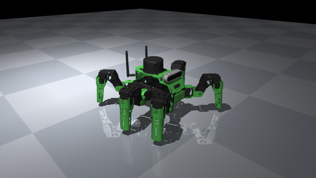

# robotics-hackathon-2026

Our 2026 robotics hackathon project. We work on a **simulated [Hiwonder JetHexa](https://www.hiwonder.com/products/jethexa)**,
a six-legged robot, in the [MuJoCo](https://mujoco.readthedocs.io/) physics simulator. You do not need the real
robot or a GPU; a laptop is enough.



## Quick start

1. Install two tools: [uv](https://docs.astral.sh/uv/) (sets up Python for you) and
   [just](https://just.systems/) (runs the project's commands). On a Mac with Homebrew:

   ```bash
   brew install uv just
   ```

   For Linux and Windows, see [docs/simulation.md](docs/simulation.md#install-the-two-tools).

2. Get the code and set it up. This installs Python, creates the virtual environment in `.venv/` and
   downloads the robot's 3D meshes:

   ```bash
   git clone git@github.com:OscarJHernandez/robotics-hackathon-2026.git
   ```

   ```bash
   cd robotics-hackathon-2026 && just setup
   ```

3. Watch the robot walk:

   ```bash
   just view
   ```

## Everyday commands

| Command | What it does |
|---|---|
| `just` | List all commands |
| `just view` | Watch the robot walk in a 3D window |
| `just sim` | Run the simulation without a window and print where the robot ended up |
| `just inspect` | Open the robot in MuJoCo's viewer and move its joints by hand |
| `just test` | Run the tests |
| `just sync` | Update your packages after pulling someone else's changes |
| `uv run python my_script.py` | Run your own script with the project's Python |
| `uv add <package>` | Add a Python package (commit `pyproject.toml` and `uv.lock`) |

You never need to activate the virtual environment or use `pip`: `just` and `uv run` do it for you.

## What's where

| Path | Contents |
|---|---|
| [sim/](sim/) | The robot model and the Python code that runs it |
| [tests/](tests/) | Tests (`just test`) |
| [docs/simulation.md](docs/simulation.md) | Full simulation guide: setup on every OS, the model, its limits, problems |
| [docs/LEARNINGS.md](docs/LEARNINGS.md) | What we have learned so far. Read it before you start |
| [docs/knock-ui.md](docs/knock-ui.md) | Knock: the Find Margarete and Call Margarete buttons for the web app, with the mockup in [docs/knock-ui/](docs/knock-ui/) |
| [docs/knock-routines.md](docs/knock-routines.md) | Knock: where Margarete is through the day, the data for the zone model |
| [CONTRIBUTING.md](CONTRIBUTING.md) | How to make a change: every change goes through a pull request |
| [AGENTS.md](AGENTS.md) | Instructions for coding agents (Claude Code, Codex, Cursor, …) |
