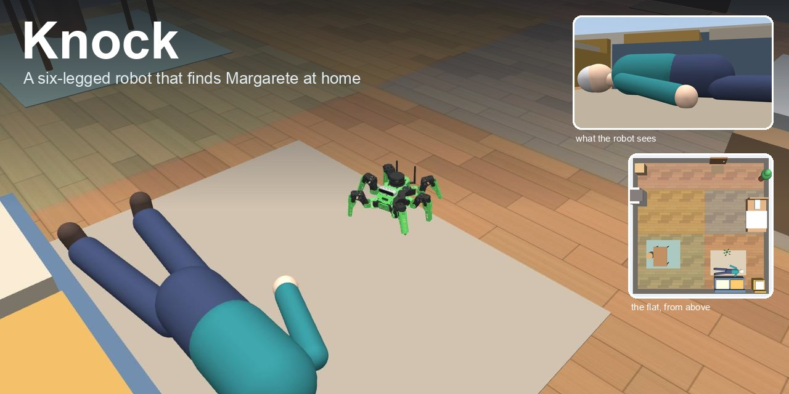
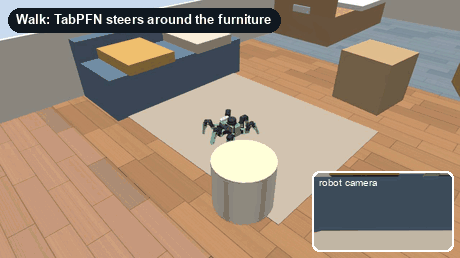
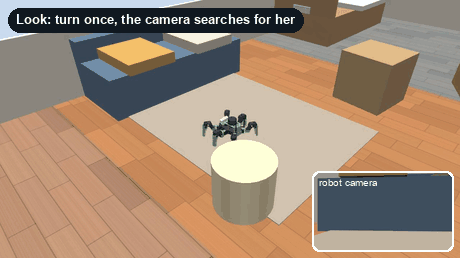
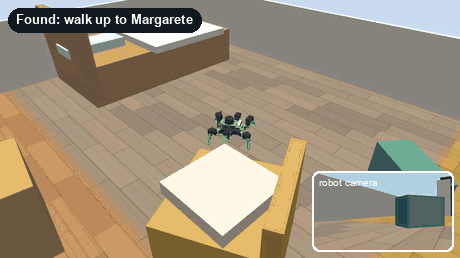

# Knock: a robot that finds Margarete

Our 2026 robotics hackathon project. A six-legged robot, the
[Hiwonder JetHexa](https://www.hiwonder.com/products/jethexa), checks in on an elderly person at home.
When she does not answer, it works out where she most likely is, walks there around the furniture, looks for
her with its own camera, and walks up to her.

Everything runs in the [MuJoCo](https://mujoco.readthedocs.io/) simulator. You do not need the real robot or a
GPU; a laptop is enough.



## What it does

A search runs in four steps, and repeats until she is found or the robot is sure nobody is home:

1. **Where is she, most likely?** A belief over five zones (bedroom, living room, dining area, kitchen, hallway)
   and "out", from her habits, a journal of where she was heard, and the time of day. TabPFN gives the starting
   belief; Bayes' rule updates it after every look.
2. **Walk there.** A TabPFN model steers the robot around furniture and clutter, using a 360° lidar and a map it
   draws itself.
3. **Look.** The robot turns once on the spot. A DINOv2 detector matches the camera picture to what Margarete
   looks like, lying or standing, and the depth camera measures how far away she is.
4. **Walk up to her.** The robot goes to about 0.6 m from her and faces her. Its destination is corrected on the
   way, each time the camera measures her distance again. Nobody there on a closer look: a false alarm, and the
   search goes on.

The web app shows all of it live: the robot's camera, the floor plan with the belief, and a spoken commentary.

Recorded from the app (2x speed). The TabPFN model is walking; the small picture is the robot's own camera.

| Walk | Look | Walk up to her |
|---|---|---|
|  |  |  |
| Around the furniture to the most likely zone | A full turn on the spot. Nobody here, so on to the next zone | She is lying on the floor; the robot spots her and stops beside her |

## What we achieved

| Piece | Result | More |
|---|---|---|
| **Walking around furniture** | Reached the target in **98%** of 200 rooms it had never seen, with a touch of furniture in 2% | [docs/dagger-report.md](docs/dagger-report.md) |
| **Recognising Margarete** | Found in **97.7%** of test pictures that show her; **0** false alarms in 213 pictures without her | [docs/app.md](docs/app.md) |
| **The whole search** | Found her in **24 of 24** test searches, in tidy and messy flats. Standing: within 1 m of her true position in 11 of 11. Lying: 9 of 13 | [docs/app.md](docs/app.md) |
| **Live web app** | Runs at [jethexa-vendetta.alpharelay.dev](https://jethexa-vendetta.alpharelay.dev), with the TabPFN model walking | [deploy/vendetta/](deploy/vendetta/README.md) |

TabPFN is used **without fine-tuning**: we only call its `fit()` on recorded examples and then `predict()`.
The walking model was found by trying 26 variants, each tested on the same unseen rooms.

| The walking model in rooms it never saw | |
|---|---|
|  |  |

**Still open**

- Lying on the floor, her position can be off by more than 1 m: the camera sometimes measures the furniture
  behind her instead of her.
- Everything is simulated. Nothing has run on the real robot yet.

## Quick start

1. Install two tools: [uv](https://docs.astral.sh/uv/) (sets up Python for you) and
   [just](https://just.systems/) (runs the project's commands). On a Mac with Homebrew:

   ```bash
   brew install uv just
   ```

   For Linux and Windows, see [docs/simulation.md](docs/simulation.md#install-the-two-tools).

2. Get the code:

   ```bash
   git clone git@github.com:OscarJHernandez/robotics-hackathon-2026.git
   ```

3. Set it up. This installs Python, creates the virtual environment in `.venv/` and downloads the robot's 3D
   meshes:

   ```bash
   cd robotics-hackathon-2026 && just setup
   ```

4. Watch the robot walk:

   ```bash
   just view
   ```

## Run the web app

```bash
just app-build
```

```bash
just app
```

Then open http://127.0.0.1:8790 and press **Find Margarete** in the Apartment panel.

A fresh clone runs the app with simpler stand-ins, and the page says which one is in use. The full version needs
a few things that are not in the repo:

| For | You need | Without it |
|---|---|---|
| The TabPFN walking model | A TabPFN token in `.env` (`TABPFN_TOKEN=...`) and the model's examples in `data/nav/` | A planned route (A*) walks instead |
| The robot's own eyes | Margarete's signature in `data/vision/` (`just person-data`, steps in [docs/app.md](docs/app.md)) | The look is simulated |
| Chat and spoken commentary | Oscar's metacon and Voice Control services | Text templates, no voice |

Ask Oscar for the data files and access. Never commit `.env` or anything in `data/`.

## Everyday commands

| Command | What it does |
|---|---|
| `just` | List all commands |
| `just view` | Watch the robot walk in a 3D window |
| `just app` | Run the web app |
| `just test` | Run the tests |
| `just search-demo` | The search on its own: numbers and pictures, no robot |
| `just search-bench` | The whole search with the robot's camera, many times, no browser |
| `just sync` | Update your packages after pulling someone else's changes |
| `uv run python my_script.py` | Run your own script with the project's Python |
| `uv add <package>` | Add a Python package (commit `pyproject.toml` and `uv.lock`) |

You never need to activate the virtual environment or use `pip`: `just` and `uv run` do it for you.

## What's where

| Path | Contents | Guide |
|---|---|---|
| [sim/](sim/) | The robot, the room and the furnished flat in MuJoCo | [docs/simulation.md](docs/simulation.md) |
| [nav/](nav/) | Walking with TabPFN: from a to b, and around furniture (`nav/dagger/`) | [docs/navigation.md](docs/navigation.md) |
| [vision/](vision/) | What the camera sees: DINOv2 features, and Margarete's signature | [docs/vision.md](docs/vision.md) |
| [homes/](homes/) | Where is she: flats, routines, and the Bayesian search | [homes/README.md](homes/README.md) |
| [app/](app/) | The web app that puts it all together | [docs/app.md](docs/app.md) |
| [tests/](tests/) | Tests (`just test`) | |
| [deploy/vendetta/](deploy/vendetta/) | How the public copy of the app runs | [README](deploy/vendetta/README.md) |

## Contributing

- [CONTRIBUTING.md](CONTRIBUTING.md): how to make a change. Every change goes through a pull request.
- [docs/LEARNINGS.md](docs/LEARNINGS.md): what we have learned so far. Read it before you start.
- [AGENTS.md](AGENTS.md): the rules and the map of the code, for people and coding agents.
- [docs/knock-ui.md](docs/knock-ui.md) and [docs/knock-routines.md](docs/knock-routines.md): the Knock concept.
