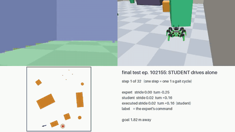
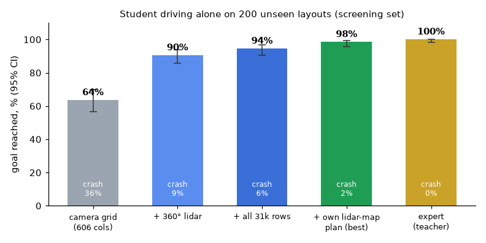

# DAgger with TabPFN: teaching the JetHexa to walk around furniture (report, 2026-11-21/22)

## The result

A TabPFN student, trained only with TabPFN's own `fit()` on rows an expert labelled, walks the simulated JetHexa to a
target in a furnished 50 m² room it has never seen, **driving entirely on its own**:

- **98.0% and 97.5% of 200 unseen layouts reached** (two start seeds), with **2.0% and 2.5% collisions**. The expert
  (the teacher, which sees the true furniture) reaches 99.5% and 100% of the same layouts.
- The best model is `v29-lidarplan`: TabPFN 3.5 on 31,586 expert rows, fed a **360° lidar** and **its own plan**: a
  shortest path on a map it builds from its lidar hits during the episode.
- It got there in 26 tested variants after the first loop (dagger1). Each was judged by driving alone on unseen layouts and compared in pairs with
  the variant it changed. The search stopped when the agreed "robust" bar was met.

| the student driving alone on unseen final-test layouts (2x speed) | |
|---|---|
|  |  |
| final test 105061: an S-shaped route around two pieces of furniture, 60 gait cycles | final test 102155: a tight detour on a short trip |

Top left of each frame: the robot's camera with the patch classes it sees. Top right: a chase camera. Bottom left:
the map and the path so far. Bottom right: the student's command, which is executed, and the expert's command, which
is only the label. **In every frame shown, the student drives**: in both final runs the expert's command was executed on
0 of 12,453 steps, and the executed command equals the student's on every step. `nav/dagger/report.py` refuses to
draw any episode where that is not true.

## 1. The task and the rules

- **Robot and room:** the simulated JetHexa hexapod in a closed 7.07 x 7.07 m room with 8 pieces of furniture (bed,
  couch, cabinet, stool, a table on four thin legs, armchair, crate, plant pot). Each layout is random; the target is a
  red pillar.
- **Command:** a continuous `(stride, turn)` held for one 1-second gait cycle. One gait cycle is one row of data.
- **Expert (teacher):** a shortest path over the true furniture (Dijkstra from the goal, 0.32 m safety margin) plus
  pure pursuit 0.4 m ahead. It can label any state, including states the student drives into.
- **Student:** two TabPFN 3.5 regressors (stride, turn). **No fine-tuning** (AGENTS.md): "training" is choosing the
  rows given to `fit()`; the pretrained weights never change.
- **DAgger:** in a round the student drives, the expert labels every visited state, and the rows join the data. Beta is
  the chance per step that the expert's command is executed instead of the student's. **All results below are beta 0:
  the student alone.**

## 2. How a variant was judged

- **Held-out layouts by role**, never used for `fit()`:
  - offline rows: 100000-100199, for offline metrics only;
  - screening: 101000-101199, closed loop;
  - confirmation: 103000-103199, once per promotion;
  - final: 102000-102199, two start seeds, 300 steps, no stuck rule, used once.
- **Paired comparison:** the same layouts and start poses for every variant, with a sign test on goal/no goal and a
  Wilcoxon test on progress. Promotion needed a paired win on 200 screening episodes, no more collisions, then a
  confirmation run.
- **Anchors** (known answers checked before trusting a table):
  - the expert reaches at least 98% on every set;
  - a noise copy of the reference (v00 against v03) shows how much two identical setups differ: about 4 points on 100
    layouts;
  - columns at fit time must equal columns at drive time;
  - every planned episode must be present exactly once.
- **Screening episodes** end at 150 steps or as "stuck" after 40 steps without getting 0.2 m closer to the goal.

## 3. Every model tried

The full generated table, with columns, context rows, fit time, intervals and paired p-values for each variant, is in
[dagger/experiments.md](dagger/experiments.md). The DAgger data rounds are in
[dagger/dagger_rounds.md](dagger/dagger_rounds.md). In short:

**dagger1 (first loop, camera only, 2026-11-21).** The student was fitted on the full 26 x 46 DINOv2 patch grid (2,400
columns). At beta 0.5 it looked excellent: 100 of 100 goals, with mean differences from the expert of 0.02 in stride and
0.05 in turn. Driving alone in 3 unseen layouts, it **collided 3 times out of 3**. It kept walking where the expert
stopped and turned on the spot, a label in only 6.5% of the rows. That failure started v2.

**v2, by idea (screening layouts, student alone):**

| idea | variants | goal | verdict |
|---|---|---|---|
| reference: the dagger1 inputs (pool 2, 606 columns) on v2 data | v03, v00 (noise copy) | 58%, 62% | the failure reproduced |
| baselines | v01 rule (heading only), v06 kNN | 50%, 16% | TabPFN earns its place; heading alone crashes |
| compact camera inputs | v02 summary (8 cols), v09 horizon scan, v10 horizon depth + DINOv2 PCA | 70%, 67%, 63% | fewer columns beat the grid, but the camera sees only 62° ahead |
| **360° lidar** | **v11** | **89%** | **promoted over v03: 32 wins / 1 loss on the same 100 layouts** |
| on top of the lidar | v12 heading-recovery rows, v13 gated stop-and-turn classifier, v14 lidar only, v16 short memory, v17 balanced context | 86-90% | none better than v11 |
| **more rows** | **v15: all 31,586 rows instead of 8,000** | **95%** | **6 wins / 0 losses against v11 (sign p 0.031)** |
| DAgger data | v18, v19, v20, v21, v22c, plus four DAgger rounds (1,200 episodes, 38,948 rows) | 84-96% | no gain over v15 |
| model and output | v23 gated with all rows, v24 8 estimators | 94%, 94% | no gain: capacity is not the limit |
| safety layers (hand-written, reported separately) | v27 stop at 0.27 m, v28 earlier stop | 94%, 91% | worse: crashes become stuck and spinning |
| **privileged ceiling** | **v08b: the expert's own look-ahead direction as input** | **100%** | **diagnosis: the missing piece is path information** |
| **the robot's own plan** | **v29: plan on its own lidar map** | **97% (98.5% on 200)** | **promoted over v15 (98.5% against 94.5% on 200 layouts), then confirmed** |
| even more rows | v31: v29 with every row (81,354 rows, all DAgger rounds) | 92% | worse than v29 |



## 4. What worked

1. **Compact inputs over the patch grid** (58% -> 70%). With 2,400 or 606 patch columns, the 3 goal columns were
   drowned. Eight summary columns did better than 606.
2. **The 360° lidar** (-> 89-90%, collisions 41% -> 10%). The camera sees 62° ahead. Most of the reference's crashes
   were into furniture beside the robot. The lidar was "not simulated yet" in the repo, so it was added to
   `sim/jethexa_sim.py` (`lidar()`, ray casts in MuJoCo).
3. **More real rows** (8k -> 31k: 89% -> 95%). TabPFN uses its context directly. With 114 columns a 31k-row fit takes
   about 4 minutes on vendetta.
4. **The robot's own plan** (-> 98.5% on 200 screening layouts, 98.0% and 97.5% on the final test). It came from a diagnosis, not a guess:
   - **The crash pattern:** in nearly every crash the expert said "stop and turn" for 2 to 3 steps before contact while
     the student walked on, with furniture 0.19 to 0.26 m beside it. Expert data almost never gets that close: 18 of
     41,084 rows are within 0.26 m.
   - **The ceiling:** a privileged ceiling run gave the student the expert's own look-ahead direction, and it reached
     100% with 0 crashes. So the student lacked *where the path goes*. It did not lack obstacle sensing or model
     capacity.
   - **The fix:** `nav/dagger/lidarmap.py` lets the robot work that out itself, using only its lidar, its odometry pose
     and the goal. It accumulates lidar hits into an occupancy map, plans a shortest path on it with the expert's
     planner, and feeds the bearing 0.4 m along the path to TabPFN. The same code runs offline on stored rows and live
     while driving (tested to give identical values).


*The same screening layout. Left: the best model reaches the target. Right: the camera-grid reference crashes. Dashed:
the expert's route, for comparison only.*


*Final test 105061. The student (green) takes a different route from the expert (dashed): it goes round the other side
of the furniture. It is planning on its own map, not copying the teacher.*

## 5. What did not work, and why

| idea | result | why, as far as the data shows |
|---|---|---|
| camera-only compact inputs (v09, v10) | 63-67% | the camera cannot see beside the robot, where most crashes happen |
| kNN (v06) | 16%, 36 stuck | no notion of which columns matter; averages neighbours into dithering |
| heading rule (v01) | 50% | knows where the goal is, not what is in the way |
| heading-recovery rows (v12) | 89% | better offline stop recall, driving unchanged |
| gated walk / stop-turn classifier (v13, v23) | 90%, 94% | offline stop recall 51% -> 82%, stops ignored 230 -> 130, crashes unchanged |
| short memory (v16), balanced context (v17), lidar-distance quotas (v19) | 84-86% | re-weighting the same rows adds no information; v19 made it hesitant |
| DAgger rounds (v18, v20, v21, v22c; rounds 1-4) | 90-96% | the rows came from states the student reaches, but they carry no path information either |
| 8 estimators (v24) | 94% | capacity is not the limit |
| safety stops (v27, v28) | 94%, 91% | the hexapod's legs touch furniture while it turns on the spot; a reflex near contact is too late |
| every row (v31, 81k) | 92% | a larger mix of mostly student-driven rows diluted the clean expert context |

## 6. Why we stopped searching

The stopping rule was agreed before the loop ran. Stop when, on fresh final layouts with two start seeds and the student
alone, **goal >= 90% with the 95% lower bound >= 85% and collisions <= 3%**, or at 8 iterations or 12 hours.

[dagger/promotion.md](dagger/promotion.md) has the full table:

| check (student alone, 300 steps) | goal (95% CI) | collisions (95% CI) |
|---|---|---|
| final, 200 layouts, seed 99 | **98.0% (95.0-99.2)** | **2.0% (0.8-5.0)** |
| final, same layouts, seed 98 | **97.5% (94.3-98.9)** | **2.5% (1.1-5.7)** |
| confirmation, 200 layouts | 97.0% (93.6-98.6) | 3.0% (1.4-6.4) |
| the expert on the final layouts | 99.5% / 100% | 0.5% / 0% |

v29 met the bar on both seeds, well inside the 8-iteration and 12-hour limits. A last check (v31, every row)
was worse, and further DAgger rounds had stopped helping. The model is within about 2 points of its teacher.

**What the remaining crashes are.** **8 of the 9** final-test collisions are into **table legs**: cylinders 5 cm across.
With 36 rays at 10° spacing, neighbouring rays are 17 cm apart at 1 m, so a leg falls between them until the robot is
very close. It is then also missing from the robot's own map. A denser lidar (real ones are usually about 1°) is the
obvious next experiment.


*Final test 102027: one of the 9 collisions in 400 runs. The student walks into the table's thin legs.*

## 7. Limits (read before using this on the robot)

- **Simulation only.** The lidar's 36 rays, 0.15 to 8 m range and lack of noise are assumptions, not the JetHexa
  lidar's datasheet.
- **The plan uses the simulator's true pose** as odometry. Real odometry drifts, and the map would smear.
- **One room family:** the 8 furniture pieces of `sim/arena_furniture.xml`, placed at random.
- **The screening set was reused across iterations** to pick winners. The confirmation and final sets were not (final:
  used once), so the final numbers are the honest ones.
- **Collisions at 2.0-2.5%** have 95% intervals reaching about 5-6%.

## 8. Learnings

Research:

- Judge a student only by driving alone. Offline agreement with the expert, and beta 0.5 runs, looked excellent in
  dagger1 while the student crashed 3 of 3 times alone.
- Run a privileged ceiling early. One run showed the gap was path information, after six variants had tuned the
  wrong thing.
- For TabPFN students, more real rows helped (8k -> 31k). Re-weighting, balancing, gating, history and more estimators
  did not. Beyond about 31k rows, more mixed data (52k, 61k, 81k) did not help and finally hurt.
- Few columns beat many: 8 summary columns beat 606 patch columns. Compact inputs also make big contexts cheap.
- Hand-written safety layers made it worse on a legged robot that touches things while turning.
- The offline "stop recall at stride < 0.02" metric is unstable for plain regressors (0% against 55% for two identical
  students). Use closed-loop runs, paired on the same layouts.

Engineering:

- **Copies to the homelab machines:** in zsh, `$h:Projects` applies the `:P` modifier. `scp file $h:Projects/...`
  silently wrote to local folders named `vendettarojects/` with exit code 0. Quote as `"${h}:..."`. `transfer.py`
  uses argument lists and checks every copy by SHA-256.
- **Benchmark memory:** a 32-process benchmark ran metacon out of memory, and earlyoom stopped Ollama and the user's
  services. `guard.py` now caps processes to free memory and stops workers under a reserve.
- **Hung pools:** `multiprocessing.Pool.map` hangs forever if a worker is killed; `ProcessPoolExecutor` raises instead.
- **Stray processes:** a `pkill -f` pattern must not match its own ssh command; use `[r]obotics...`.
- **TabPFN licence:** a key needs a one-time licence acceptance on ux.priorlabs.ai. A successful `fit()` proves nothing
  where the weights are already cached; `browser_auth.check_license_accepted` does.
- **TabPFN 3.5 speed:**
  - CPU (metacon): a 12k x 114 fit in 318 s.
  - M4 Pro MPS (vendetta): 8k x 114 in about 30 s, 31k in about 4 min, 61k in 12.5 min, 81k in 23 min.
- **Headless rendering:** victory and metacon had no OpenGL libraries. With Mesa EGL installed, MuJoCo renders on the
  Radeon iGPU at about 1 ms per picture.

All of these are also in [LEARNINGS.md](LEARNINGS.md).

## 9. Reproduce

Run on a machine with the data (vendetta) and `TABPFN_TOKEN` in the environment or the gitignored `.env`:

```bash
uv run --group ml --group vision python -m nav.dagger.experiment collect --name round0 --procs 4 --n-envs 16
uv run --group ml --group vision python -m nav.dagger.experiment collect --name screen --max-steps 150 --stuck-steps 40 --procs 4
uv run --group ml --group vision python -m nav.dagger.experiment collect --name offline_expert --procs 4
uv run --group ml --group vision python -m nav.dagger.lidarmap add --name round0 offline_expert
uv run --group ml --group vision python -m nav.dagger.experiment run --variant nav/dagger/variants/v29-lidarplan.yaml --closed-count 100
uv run --group ml --group vision python -m nav.dagger.stage analyse v29-lidarplan --closed-count 100
uv run --group ml --group vision python -m nav.dagger.experiment run --variant nav/dagger/variants/v29-lidarplan.yaml --closed-set final --closed-max-steps 300 --closed-stuck-steps 0 --tag final
uv run --group ml --group vision python -m nav.dagger.report --out docs/dagger
```

Each `collect` writes Parquet parts that must be merged before the next step (`merge.merge_dir`). The report rebuilds
every table and picture here from `data/nav/dagger/v2/`.

## 10. Where everything is

| what | where |
|---|---|
| code | `nav/dagger/` (variants in `variants/`), `sim/jethexa_sim.py` (lidar) |
| this report's tables, pictures, GIFs | `docs/dagger/` (generated by `nav/dagger/report.py`) |
| all v2 data, experiments, STATUS.md, incidents.md | vendetta: `~/Projects/robotics-hackathon-2026/data/nav/dagger/v2/` (gitignored) |
| DAgger rounds and expert reference sets | metacon: same path (also copied to vendetta) |
| dagger1 data and videos | laptop `data/nav/dagger/dagger1/`; a copy for krishna on victory |
| replay videos (MP4) | laptop `data/nav/dagger/v2/videos/` |

## 11. Next steps

1. **A denser lidar** (e.g. 360 rays at 1°), aimed at the table-leg crashes. It needs a new round 0 (about 15 min) and
   one refit.
2. **Check the simulated lidar against the real JetHexa lidar** (rays, range, noise), and test `lidarmap.py` with real
   odometry drift.
3. **Backlog:** DINOv3 features, fitting on the legion RTX 2080, the camera's role once the lidar is denser.
