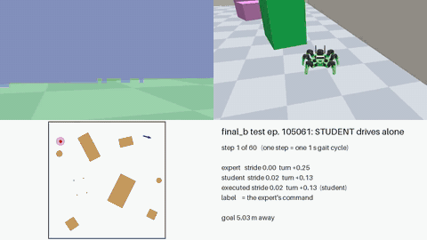
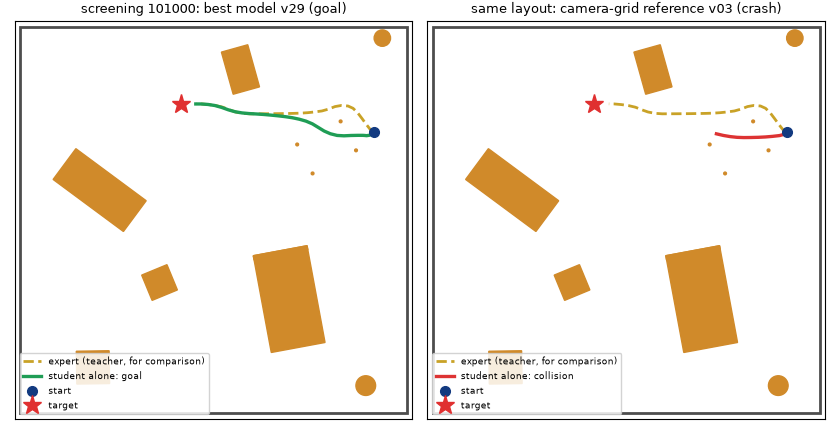
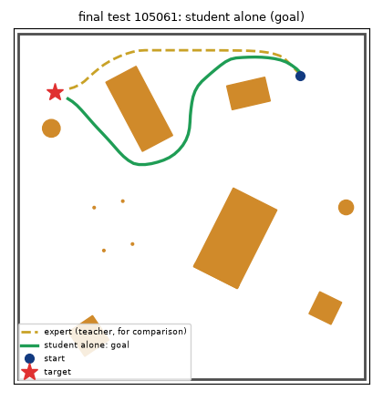
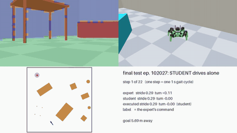

# Teaching the JetHexa to walk around furniture with TabPFN (report, 21-22 Nov 2026)

## In short

- **Goal:** a model that walks the simulated JetHexa robot to a target in a furnished room it has never seen.
- **Best model, v29:** TabPFN, taught only with TabPFN's own `fit()` (no fine-tuning). It uses a 360° lidar and
  plans a route on a map it draws from its own lidar.
- **Result:** in 200 rooms it had never seen, it reached the target **98.0%** of the time and hit furniture **2.0%**
  of the time. With a second set of start positions: **97.5%** and **2.5%**. It drove entirely alone. The expert
  teacher reached 99.5% and 100%.
- **How we found it:** 26 models after a first attempt. Each one changes one thing, and each is tested on the same
  rooms as the model it changes.
- **Cost:** about 5 hours on two computers (vendetta and metacon), 8.2 computer-hours, 7,400 simulated runs.

| the best model driving alone, in rooms it never saw (2x speed) | |
|---|---|
|  |  |
| room 105061: an S-shaped route around two pieces of furniture | room 102155: a tight detour on a short trip |

**These are the model, not the teacher.** In the 400 final runs (12,453 steps), the teacher's command was used on
0 steps. `nav/dagger/report.py` checks every step and refuses to draw a run where the teacher drove.

How to read a frame:

| part of the frame | shows |
|---|---|
| top left | the robot's camera, coloured by what it sees |
| top right | a camera following the robot |
| bottom left | the map and the path so far |
| bottom right | the model's command, which is what the robot does, and the teacher's command, which is shown only for comparison |

## Words used here

| word | meaning |
|---|---|
| **expert** or **teacher** | a program that knows the true room. It finds the shortest safe path and steers along it. It shows the model what to do. |
| **model** or **student** | TabPFN. It sees only what the robot's sensors see, and learns to copy the teacher. |
| **row** | one step of one run: what the robot sensed, and the teacher's command for that moment. One step is one stride of the legs (1 second). |
| **`fit()`** | how TabPFN learns: you hand it example rows. Its weights never change, so "training" means choosing which rows to give it. |
| **DAgger** | the student drives and the teacher writes down what it should have done. Those rows are added to the examples, so the student learns from its own mistakes. |
| **lidar** | a sensor that spins and measures the distance to things all around the robot (here 36 directions, 10° apart). |
| **variant** | one model setup to test, named v00 to v31. Each changes one thing. |
| **driving alone** | the student's command is used on every step. All results here are driving alone. |

## 1. The task

- **Room:** a closed 7 x 7 m room with 8 pieces of furniture: bed, couch, cabinet, stool, a table on four thin
  legs, armchair, crate and plant pot. Every room is a new random layout. The target is a red pillar.
- **Command:** every second the model picks a stride length and a turn.
- **Success:** the robot reaches the target. A **crash** is touching furniture. **Stuck** means 40 steps without
  getting 0.2 m closer.

### How a path is planned

**The teacher** (`nav/dagger/expert.py`) knows where the furniture really is. It works in four steps:

1. **Grid.** The room becomes a grid of 5 cm squares. A square is *blocked* if it is closer than 0.32 m to furniture
   or a wall, which is about the robot's half-width plus a margin. A path through free squares keeps the robot clear.
2. **Distance to the goal from everywhere.** One Dijkstra search, started at the goal, gives every free square its
   shortest walking distance to the goal. It moves to the 8 neighbouring squares (diagonals cost √2 times more) and
   never cuts a corner past a blocked square. This is A* with no heuristic, run once per room from the goal.
3. **The path from where the robot is:** always step to the neighbouring square that is closest to the goal.
4. **Steering (pure pursuit):** take the point 0.4 m along that path.
   - **Turn:** 0.6 times the angle to that point, within the turn limit.
   - **Facing away** (the angle is over 46°): stop and turn on the spot.
   - **Otherwise walk:** the stride is shorter the bigger the angle, and slower in the last 0.5 m.

Because step 2 covers every square, the teacher can give the right command from *any* place the student wanders
into. DAgger needs exactly that.

**v29's own planner** (`nav/dagger/lidarmap.py`) uses the same steps on a map the robot draws itself, from what a real
robot has: its lidar, its position and the goal.

- **The map:** a grid of 10 cm squares, all assumed free at the start. Every step, the 36 lidar hits mark squares as
  obstacles, and they stay marked for the rest of the run.
- **Planning:** obstacles are grown by the same 0.32 m, a Dijkstra search runs from the goal, and the path goes
  downhill as above.
- **What TabPFN gets:** the direction of the point 0.4 m along this path, as two numbers (sin and cos of the angle
  from the robot's heading). TabPFN still decides the stride and turn itself.
- **Difference from the teacher:** places the lidar has not seen are assumed free, so the plan can be wrong until an
  obstacle shows up. A table leg that falls between two rays never shows up in time. That is the cause of the
  remaining crashes.

## 2. How the best model was found

### The rules (agreed before starting)

1. **One change per variant.** Each variant is compared with the model it changes.
2. **Same rooms for every variant.** Every variant drives the same 100 test rooms ("screening") from the same
   start positions. So a difference between two variants comes from the model, not from easier rooms.
3. **Count wins and losses room by room.** A win is a room where the new variant reaches the target and the old one
   does not. A sign test says whether the wins could be luck. Two copies of the same setup differ by about 4 points
   (v00 against v03), so smaller gaps mean nothing.
4. **Promote only after 200 rooms.** A variant that looks better on 100 rooms drives 100 more. It becomes the new
   leader only if it still wins and crashes no more.
5. **Check on rooms never used before.** The leader then drives 200 new "confirmation" rooms. At the end it drives
   200 "final" rooms, used once, from two different sets of start positions.
6. **Stop** when, on the final rooms, the model reaches the target at least 90% of the time (and at least 85% at
   the low end of the error range) and crashes at most 3% of the time, for both start sets. Also stop at 8 rounds,
   12 hours, or 2 rounds without progress.
7. **Sanity checks:** the teacher must reach at least 98% of every test set, so that the rooms are possible.

### What happened, step by step (22 Nov, times in Berlin)

| time | step | result | decision |
|---|---|---|---|
| 01:59-02:26 | **Collect data.** The teacher drives 1,000 training rooms (31,586 rows), plus the test rooms. vendetta and metacon run in parallel. | teacher: 1,000 of 1,000 reached | data ready |
| 02:29-02:59 | **Round 1: 8 variants.** The first attempt's camera setup (v03), simpler inputs, a 360° lidar, and two simple baselines. | camera only 58%, lidar **89%** | lidar wins on 200 rooms: 56 wins, 2 losses. **v11 is the leader.** |
| 02:59-03:38 | **Round 2: 6 changes to v11.** Extra rows, a stop/turn switch, memory, balanced examples, lidar only, and all 31,586 rows instead of 8,000. | all rows **95%** (6 wins, 0 losses) | **v15 is the leader.** |
| 02:55-05:00 | **Round 3: does more DAgger data help?** metacon runs 4 DAgger rounds (1,200 runs where the student drives). vendetta tests those rows, a 2-step output, 8 estimators and safety stops. | everything 91-96% | **no gain: a plateau at about 95%** |
| 05:00-05:10 | **Find out why.** We look at every crash: in each one the teacher stops and turns for 2-3 steps, and the student walks on. Then a test that cheats on purpose: give the student the teacher's next waypoint direction (v08b). | the cheating model: **100%** | the student is missing *where the path goes*, not obstacle sensing |
| 05:15-05:47 | **Give it a path without cheating.** v29 draws a map from its own lidar hits, plans a shortest path on it, and gets the direction of that path as an input. | **97%** on 100 rooms, **98.5%** on 200 (9 wins, 1 loss against v15) | **v29 is the leader** |
| 05:47-06:33 | **Final checks** on rooms never used before. | confirmation 97.0%; final 98.0% and 97.5% | **the stop bar is met** |
| 06:32-07:05 | **One last idea:** v29 with every row we have (81,354). | 92% | worse; v29 stays the best |

### From v03 to v11: how the lidar model came about

v03 is the first attempt's setup, rebuilt on the new data. Before round 1 started, we planned a chain of variants,
each adding one thing to the one before. All of them then ran in round 1 on the same 100 rooms:

| step | variant | what changed | inputs | reached | head-on / side crashes |
|---|---|---|---|---|---|
| start | **v03** | the camera picture as 606 patch inputs (what each patch shows and how far away it is) | 606 | 58% | 23 / 18 |
| 1 | **v02** | drop the patches; keep the goal and 5 summary numbers (for example "how much of the view ahead is blocked") | 8 | 70% | 22 / 8 |
| 2 | **v09** | add a scan of the camera's horizon: what is in each of 15 directions ahead | 18 | 67% | 23 / 10 |
| 3 | **v10** | instead, the depth in each of the 15 directions plus 4 numbers describing what it looks like (DINOv2) | 78 | 63% | 26 / 10 |
| 4 | **v11** | v10 plus the lidar: the distance to the nearest thing in 36 directions all around | 114 | **89%** | **6 / 4** |

What this showed:

- **Too many inputs hurt.** With 606 patch inputs, the 3 inputs that say where the target is get lost. Eight inputs
  did better (v02).
- **Better camera inputs stopped helping** (v09, v10: 63-67%). Every camera-only model kept hitting furniture: 22-26
  times head-on and 8-18 times from the side, per 100 rooms. The camera sees only 62° ahead and its distances are
  rough.
- **The lidar fixed it.** It gives exact distances all around, and crashes fell from 36 to 10 per 100 rooms. On 200
  rooms, v11 beat v03 in 56 rooms and lost in 2.
- The simulator had no lidar before this work. `lidar()` was added to `sim/jethexa_sim.py` for v11.

### Variant numbers you will not find in the results

| number | what it was | why it has no result |
|---|---|---|
| v04, v05, v06p | extra recovery rows, a 2-step output, and nearest neighbours, all on v03's camera patches | planned, not run. After round 1 the lidar was far ahead, so the same ideas were tested on top of it: v12 (recovery rows) and v13 (2-step output). |
| v08 | the cheating test on top of v11 | replaced by v08b, the same test on the later leader v15 |
| v26c | the student that drove DAgger round 4 | a data collector, not a candidate: it drove 300 training rooms and was never tested on the screening rooms. v22c drove round 3 and was also tested. |
| v07, v25, v30 | nothing | numbers skipped; no variant was ever defined under them |

The files for v04, v05, v06p and v08 are still in `nav/dagger/variants/` and can be run.

## 3. Every model tried

Results on the 100 screening rooms, driving alone. The full table, with the number of inputs, rows, fitting time
and statistics, is in [dagger/experiments.md](dagger/experiments.md).

| idea | variants | reached | verdict |
|---|---|---|---|
| **first attempt (dagger1, 21 Nov):** the camera picture cut into 1,196 patches | dagger1 | 3 crashes in 3 rooms alone | looked perfect while the teacher helped; failed alone |
| the first attempt's setup on the new data (606 patch inputs) | v03, and a copy v00 | 58%, 62% | the failure repeats; the two copies show the noise (4 points) |
| simple baselines: a hand rule, nearest neighbours | v01, v06 | 50%, 16% | TabPFN is much better |
| fewer, summarised camera inputs | v02, v09, v10 | 70%, 67%, 63% | better, but the camera sees only 62° ahead |
| **360° lidar** | **v11** | **89%** | **leader 1** |
| changes on top of the lidar | v12, v13, v14, v16, v17 | 86-90% | none better than v11 |
| **all 31,586 rows instead of 8,000** | **v15** | **95%** | **leader 2** |
| DAgger rows (4 rounds, 38,948 rows) | v18, v19, v20, v21, v22c | 84-96% | no gain |
| a 2-step output (walk or turn first), 8 estimators | v23, v24 | 94%, 94% | no gain |
| hand-written safety stops | v27, v28 | 94%, 91% | worse |
| cheating test: the teacher's path direction | v08b | 100% | shows what is missing |
| **its own plan on its own lidar map** | **v29** | **97% (98.5% on 200)** | **best** |
| every row we have (81,354) | v31 | 92% | worse |


The DAgger rounds are listed in [dagger/dagger_rounds.md](dagger/dagger_rounds.md), and the final checks in
[dagger/promotion.md](dagger/promotion.md).

## 4. What worked, and why

1. **Fewer, better inputs** (58% to 70%). 606 picture-patch inputs drowned out the 3 inputs that say where the target
   is. Eight summary numbers did better.
2. **A 360° lidar** (to 89%; crashes from 41% to 10%). It gives exact distances all around. The camera sees 62°
   ahead and judges distance roughly.
3. **More real examples** (8,000 to 31,586 rows: 89% to 95%). TabPFN learns directly from the examples it is given.
4. **Its own plan** (to 98%). The cheating test showed that the student needed to know where the path goes. v29 works
   this out itself, from its lidar, its position and the goal. The same code runs on stored data and while
   driving, and a test checks that both give the same values.



*The same room. Left: v29 reaches the target. Right: the first setup crashes. Dashed: the teacher's route, for
comparison.*



*v29 (green) goes round the other side of the furniture from the teacher (dashed). It plans on its own map rather
than copying.*

## 5. What did not work

| idea | why it did not help |
|---|---|
| camera-only inputs | the camera sees only 62° ahead, with rough distances: 30-41 crashes per 100 rooms |
| nearest neighbours, a hand rule | no sense of which inputs matter; the rule knows where the target is but not what is in the way |
| extra recovery rows, a stop/turn switch | the model stopped better on paper, but crashed just as often while driving |
| memory, balanced examples | reshuffling the same rows adds no new information |
| DAgger rounds | new rows from where the student goes, but still no information about the path |
| 8 estimators | the model was not too small |
| safety stops | the hexapod's legs touch furniture while turning, so stopping near furniture is too late; it got stuck instead |
| every row (81k) | mostly student-driven rows dilute the clean teacher examples |

## 6. Why we stopped

- The stop bar was set before the work began, and v29 met it on rooms never used before:

  | final check (driving alone, 300 steps) | reached (95% range) | crashed (95% range) |
  |---|---|---|
  | 200 rooms, start set A | **98.0%** (95.0-99.2) | **2.0%** (0.8-5.0) |
  | same rooms, start set B | **97.5%** (94.3-98.9) | **2.5%** (1.1-5.7) |
  | 200 confirmation rooms | 97.0% (93.6-98.6) | 3.0% (1.4-6.4) |
  | the teacher on the final rooms | 99.5% / 100% | 0.5% / 0% |

- v29 is within about 2 points of its teacher. The last extra idea (v31) was worse, and DAgger had stopped helping.
- **What the remaining crashes are:** 8 of the 9 final crashes are into the **table's legs**, which are 5 cm thick.
  The lidar's rays are 10° apart, 17 cm at 1 m, so a leg can fall between two rays until the robot is very close.



*Room 102027: one of the 9 crashes in 400 final runs. The robot walks into a table leg its lidar did not see in time.*

## 7. Computers and compute

| computer | hardware | what it did |
|---|---|---|
| **laptop** | Apple M3, 16 GB | the coordinator: Claude ran here, sent jobs, merged data, made this report. No TabPFN fits (too little memory). |
| **vendetta** | Mac, Apple M4 Pro (12 cores), 64 GB | **TabPFN fits and tests**: 31 of the 34 variant tests (TabPFN runs on the Apple GPU), plus 1,450 of the 2,400 teacher runs. |
| **metacon** | AMD Ryzen AI Max+ 395 (32 threads), 128 GB | **simulation in bulk**: data with 8 processes, all 4 DAgger rounds, 3 comparison runs. TabPFN runs on the CPU here. |
| victory | AMD Ryzen AI Max+ 395, 64 GB | the first attempt only (21 Nov), and a copy of the data for krishna |
| legion | NVIDIA RTX 2080 | tested once, then dropped (Oscar's call) |

**Why this split:** fitting TabPFN on 31,586 rows takes **4 minutes on vendetta and 20 minutes on metacon** (no GPU
support there). So fits and tests went to vendetta, and simulation-heavy jobs, which scale with CPU cores, went to
metacon.

**Totals for the search (22 Nov, 01:59-07:05, about 5 hours with both computers working in parallel):**

| computer | busy hours | runs simulated | steps simulated | of which TabPFN fitting |
|---|---|---|---|---|
| vendetta | 4.6 h | 4,850 | 145,930 | 1.75 h |
| metacon | 3.6 h | 2,550 | 81,051 | 1.47 h |
| **total** | **8.2 h** | **7,400** | **226,981** | **3.2 h** |

- One simulated step is one second of robot walking, so the search simulated about **63 hours of walking**.
- The first attempt (21 Nov) added 1,103 runs (36,088 steps) on all four computers: round 0 took about 7 minutes,
  split across the laptop, vendetta, metacon and victory.
- Every job and its time is in [dagger/compute.md](dagger/compute.md), generated from the job records each machine
  writes.
- **Not counted:** tests, debugging, rendering videos, and the lidar-map preprocessing (12 s per 9,500 rows). Each of
  these is minutes, not hours.

## 8. Limits

- **Simulation only.** The lidar settings (36 rays, 0.15-8 m, no noise) are guesses, not the real JetHexa lidar.
- **The plan uses the simulator's exact position.** A real robot's position estimate drifts, which would smear its map.
- **One kind of room:** the same 8 pieces of furniture in random places.
- **The screening rooms were used again and again** to pick winners, so screening numbers flatter a little. The
  confirmation and final rooms were not reused: those are the honest numbers.
- **Crashes of 2-2.5%** could be as high as about 5-6% (the 95% range).

## 9. Learnings

**About the research**

- **Judge a model only by driving alone.** The first attempt matched the teacher almost perfectly while the teacher
  helped, then crashed 3 times out of 3 alone.
- **Run a "cheating" test early.** Giving the model the answer it lacks shows whether that is the gap. It found the
  real problem in one run, after six variants had tuned the wrong thing.
- **For TabPFN, more real examples helped up to about 31k rows.** Reshuffling, balancing, gating, memory and more
  estimators did not. Beyond 31k, adding more mixed data did not help and finally hurt.
- **Few inputs beat many:** 8 summary numbers beat 606 picture-patch inputs. Fewer inputs also make fits faster.
- **Hand-written safety rules made a legged robot worse:** it touches things while turning.
- **Offline scores can mislead:** "stops correctly" scored 0% and 55% for two identical models. Trust driving tests on
  the same rooms.

**About the engineering**

- **Copying files in zsh:** `$h:Projects` silently means something else in zsh: `scp` wrote to a local folder and
  reported success. Write `"${h}:..."`. `transfer.py` checks every copy with SHA-256.
- **Memory:** a 32-process job ran metacon out of memory and stopped other services. `guard.py` now limits processes
  to the free memory.
- **Hangs:** `multiprocessing.Pool` hangs forever if a worker dies, while `ProcessPoolExecutor` raises an error.
  Use the latter.
- **TabPFN licence:** a new key must accept the licence once. A working `fit()` proves nothing if the weights were
  cached; `browser_auth.check_license_accepted` does.
- **Rendering on Linux without a screen** needs Mesa EGL. MuJoCo then renders on the Radeon chip in about 1 ms per
  picture.

All of these are also in [LEARNINGS.md](LEARNINGS.md).

## 10. Reproduce, and where the data is

On vendetta, with `TABPFN_TOKEN` set in the environment or in the gitignored `.env`:

```bash
uv run --group ml --group vision python -m nav.dagger.experiment collect --name round0 --procs 4 --n-envs 16
uv run --group ml --group vision python -m nav.dagger.experiment collect --name screen --max-steps 150 --stuck-steps 40 --procs 4
uv run --group ml --group vision python -m nav.dagger.experiment collect --name offline_expert --procs 4
uv run --group ml --group vision python -m nav.dagger.lidarmap add --name round0 offline_expert
uv run --group ml --group vision python -m nav.dagger.experiment run --variant nav/dagger/variants/v29-lidarplan.yaml --closed-count 100
uv run --group ml --group vision python -m nav.dagger.stage analyse v29-lidarplan --closed-count 100
uv run --group ml --group vision python -m nav.dagger.experiment run --variant nav/dagger/variants/v29-lidarplan.yaml --closed-set final --closed-max-steps 300 --closed-stuck-steps 0 --tag final
uv run --group ml --group vision python -m nav.dagger.report --out docs/dagger
```

Each `collect` writes parts that must be merged (`merge.merge_dir`) before the next step. `report.py` rebuilds
every table and picture in `docs/dagger/`, and with `--jobs` it rebuilds `compute.md`.

| what | where (all gitignored, not in the repo) |
|---|---|
| all v2 data, every experiment, STATUS.md (the search log), incidents.md | vendetta: `~/Projects/robotics-hackathon-2026/data/nav/dagger/v2/` |
| DAgger rounds 1-4 and test sets (also copied to vendetta) | metacon: the same path |
| first attempt's data and videos | laptop `data/nav/dagger/dagger1/`; a copy for krishna on victory |
| full-length videos (MP4) | laptop `data/nav/dagger/v2/videos/` |

## 11. Next steps

1. **A denser lidar** (for example 360 rays, 1° apart) for the table-leg crashes. This needs about 15 minutes of
   data collection and one new fit.
2. **Compare with the real robot:** check the real JetHexa lidar (rays, range, noise), and test the map with real
   position drift.
3. **Later:** DINOv3 picture features, fitting on legion's GPU, and what the camera adds once the lidar is denser.
