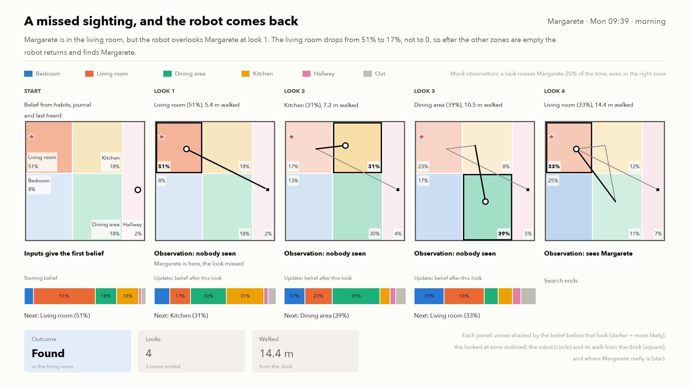

# homes: where is she? Synthetic Knock data and a Bayesian search

**Journal + habits + floor plan → where to search, in which order.** This folder makes synthetic residents living in
the MuJoCo arena, and a Bayesian search (`search.py`) that turns what is known about a resident into a search path for
the robot. Everything is simulated and drawn from a seed: the same seed gives the same files.

Start with `just search-demo`: it prints the results tables below and writes ten pictures to `data/search_examples/`
(six one-shot examples and four full search loops). `just search-sim` runs one search in MuJoCo, with the simulated
JetHexa walking to each proposed zone.

## Commands

Run from this folder (`PROJECT` is the repo root; it holds the Python environment).

```bash
PROJECT=..
uv run --project $PROJECT --group ml python search_demo.py                          # the search: numbers + 10 pictures
uv run --project $PROJECT --group ml python sim_bridge.py --flat 0 --zone kitchen   # one search in MuJoCo (nav/dagger walks)
uv run --project $PROJECT --group ml python search_demo.py --tune                   # pick search.WEIGHTS (train residents)
uv run --project $PROJECT --group ml python generate.py --residents 8500 --csv      # data/*.parquet (+ .csv)
uv run --project $PROJECT --group ml python render.py                               # data/maps/sheet.png + 24 floor plans
uv run --project $PROJECT --group ml python prior.py                                # data/cold_prior.json
uv run --project $PROJECT --group ml python check.py --residents 10                 # TabPFN smoke test, ~6 min on CPU
uv run --project $PROJECT --group ml python example.py --row 30                     # one TabPFN example, explained
uv run --project $PROJECT --group ml python -m unittest test_homes.py -v            # 30 tests
```

## The flat: the MuJoCo arena with five named zones

Every flat is the simulator's arena (`sim/arena_furniture.xml`): one closed, square room of 50 m² (7.07 × 7.07 m) with the
arena's 8 pieces of furniture. The floor is divided into five zones, and every point of the floor is in exactly one:

| Zone | Furniture from the arena | Where she is |
|---|---|---|
| `bedroom` | bed | by the bed |
| `living_room` | couch, armchair | in front of the couch or the armchair |
| `dining_area` | table, stool | at the table |
| `kitchen` | cabinet (stands in for the kitchen counter) | by the cabinet |
| `hallway` | crate, plant pot, the door and the robot's dock | by the front door |

The hallway is a 1.3–1.6 m strip along one wall; the other four zones are the quarters of the rest of the room, and the
kitchen always shares an edge with the dining area. The split lines, which quarter is which, the furniture positions and
the hallway's wall are random. Furniture stands with its back to a wall, except the table and stool. Each zone has one
viewing pose per spot (the living room has two: couch and armchair), at least 0.30 m (the robot's radius) from all furniture.

`flats.arena_layout(flat, zone)` returns the layout `Arena.apply()` in `vision/scene.py` takes, with the red target pillar
standing in for her; a test opens flats in MuJoCo and checks that the furniture stands where the flat says.
`flats.to_app_zones(flat)` has the shape of `ZONES` in `app/knock.py` (the app still uses its old six names; switching it
is a follow-up). The arena has no real door; `door` is where it would be.


## The resident

A day has 3 parts: **morning 07:00–12:00, afternoon 12:00–18:00, evening 18:00–22:30**. Each resident has, for weekdays and
for weekends, a probability over the five zones for each part, plus a probability of being out (`residents.py`). Each day
she draws one zone per part. At night she is in the bedroom. Residents come in 8 flavours (`standard, early_riser,
night_owl, kitchen_person, day_care, restless, frail, living_room_reader`); each resident's table is a jittered copy, with
shop afternoons, day-care mornings or a weekend outing on chosen weekdays.

**Stated habits** (`residents.stated_habits`) are what she or her carer would write on a form: her usual zone per part of
the day (weekday and weekend) and her regular outings. The form is imperfect: in 30% of the parts of the day it names her
second most likely zone instead of the first.

## The Bayesian search (`search.py`)

Nothing is trained. The belief is counting with Bayes' rule, for a check-in at a given hour and weekday:

1. **Population**: how often people are in each zone in this part of the day (from the train residents), worth 8 records.
2. **Habits**: her stated usual zone gets 2 extra records; `out` gets 32 on the weekday of a stated outing.
3. **Journal**: each of her own records in this part of the day (same weekday type) counts as one record.
4. **Last heard**: if the newest record is from this same part of today, she has most likely not moved. Bayes' rule, with a
   10% chance that the record was logged in a neighbouring zone.

The weights (8, 2, 32) are the ones with the lowest log loss on the check-ins of **train** residents (`--tune`).

**The search goes where she most probably is.** `plan()` checks the zones from the most to the least likely; distance does
not change the order (only a tie within 1 point goes to the nearer zone). The floor plan defines the zones, the viewing
poses and the path, and measures the metres.

### The loop: proposal → observation → update → next zone, until found

```python
search = Search(flat, beliefs(...)["last_heard"])
while (goal := search.goal()) is not None:   # {"zone", "x", "y", "heading_deg", "p"}: the most likely zone's viewing pose
    seen = ...walk there and look...          # observe() is the mock; the simulator plugs in here (sim_bridge.py)
    search.report(seen)                       # Bayes' rule on what was seen
search.status                                 # "found", "nobody_home" (95% sure) or "gave_up" (12 looks)
```

The observation is a mock with a **false-negative rate**: the robot overlooks her in 20% of the looks at the zone she is in
(`MISS_RATE`), and never sees her where she is not. So a miss does not rule a zone out; `after_miss()` only lowers it:

    P(zone | not seen) = P(zone) · 0.2 / (1 − P(zone) · 0.8)        and the others grow by 1 / (1 − P(zone) · 0.8)

A 51% zone drops to 17% after one empty look, and can become the most likely zone again once the others are empty.
Every empty look also raises `out`; at 95% the loop stops with "nobody home".

### Results (`search_demo.py`: 120 test residents, 28 days of journal, 4,800 check-ins)

Test residents are people and flats the weights never saw.

**One look per zone, perfect look** (check-ins with her at home; belief top = the most likely class is where she is):

| Strategy | Zones checked | Metres | Belief top |
|---|---|---|---|
| Random order | 2.98 | 11.4 | |
| Nearest zone first (floor plan only) | 3.30 | 7.2 | |
| Last heard first, then nearest | 2.12 | 7.4 | |
| Most likely first: population only | 2.13 | 8.7 | 38% |
| Most likely first: + stated habits | 2.09 | 8.5 | 51% |
| Most likely first: + journal | 1.87 | 7.8 | 54% |
| **Most likely first: + last heard (the search)** | **1.54** | **6.5** | **72%** |
| Most likely first: her true routine (best possible without last heard) | 1.78 | 7.6 | 57% |
| Comparison: same belief, order with the fewest expected metres | 2.13 | 5.6 | |

- The search finds her after 1.54 zones on average, against 3.30 for "nearest first" and 2.12 for "last heard first".
- Before she is heard in this part of the day (half the check-ins), habits and journal do the work: 1.94 zones against
  1.86 for her true routine, which no method can beat. Once she was heard, 1.13 zones.
- The last row is `plan_shortest()`: it walks less (5.6 m) by looking into near zones on the way, but checks more zones.
  It is there for comparison; the search itself goes by probability.
- She was out in 15% of check-ins; the belief said out (over 50%) for 95% of those and was right 90% of the times it said so.

**The loop with the imperfect look (20% misses)**, check-ins with her at home; looks and metres over the searches that found her:

| Strategy (all with the same imperfect look) | Found | Looks | Metres |
|---|---|---|---|
| **Bayesian loop: look, update the belief, pick again** | **98.9%** | 2.22 | 8.5 |
| Same belief, but a miss rules the zone out (no second look) | 80.1% | 1.53 | 6.5 |
| Nearest zone first, round after round | 96.5% | 4.20 | 10.0 |
| Last heard first, then rounds | 98.1% | 3.10 | 10.4 |

- **The update is what makes the loop work**: treating a miss as certain loses her in 1 search out of 5. In 25% of the
  searches the Bayesian loop went back to a zone it had already looked at, and then found her.
- When she is out, the loop ends with "nobody home" in 49% of the cases within 12 looks (3.6 looks on average); in the rest
  the belief in `out` started too low to reach 95% in 12 looks.

With one week of journal (the 7-day data in `data/`) the journal step adds only 1–2 points; it needs a few weeks of
records to correct a wrong form.

### The pictures (`data/search_examples/`)

Six one-shot examples (`example_1..6.png`: inputs, belief step by step, the search on the floor plan):

| | What it shows |
|---|---|
| 1 | The stated habits point the way: the form says bedroom on weekday mornings, most people are in the living room; found in the bedroom. |
| 2 | The journal overrules the form: it says kitchen, but she was there on 1 of 20 weekday afternoons; kitchen 28% → 14%. |
| 3 | Heard a moment ago: heard in the bedroom 11 minutes earlier; bedroom 18% → 85%. |
| 4 | Last heard is old news: heard in the bedroom 9.5 hours ago; the search still goes to the living room (41%) and finds her. |
| 5 | First guess wrong: not in the living room (48%); the kitchen rises from 24% to 46% and she is there. |
| 6 | Probably not home: a stated outing makes `out` 61%. |

Four loops (`loop_1..4.png`: one panel per look, with the observation, the updated belief and the next proposal): found
at the first look; wrong guess, update, next zone; **a missed sighting and the robot comes back**; nobody home.



`search_figure.text_problems()` measures every text in every picture; `search_demo.py` fails if two texts overlap or one
runs off the page.

## In the simulator: the search tells the robot where to go (`sim_bridge.py`)

The search is the orchestrator, the navigation work in `nav/dagger/` is the legs:

| Piece | From | Role |
|---|---|---|
| `Search.goal()` | `homes/search.py` | the next zone and its viewing pose (x, y, heading) |
| `FlatEnv` | `homes/sim_bridge.py`, a subclass of `nav.dagger.env.SimEnv` | the MuJoCo arena with a flat's furniture, the robot at the dock, a goal that changes between walks |
| driver | `nav.dagger.expert.Expert` today; the TabPFN student later | `act(state) -> (stride, turn)`: walks the JetHexa to the goal around the furniture |
| observation | `search.observe()` (mock) | goes into `Search.report(seen)`; a person detector replaces it later |

```bash
uv run --project $PROJECT --group ml python sim_bridge.py --flat 0 --zone kitchen
#   look 1: living_room   40%  walked  5.4 m in  43 s, robot at (+1.53, -1.67) in the living_room  ->  nobody seen
#   look 2: kitchen       32%  walked  4.7 m in  42 s, robot at (-1.87, +1.47) in the kitchen  ->  FOUND
```

Checked on 12 flats × 4 places: all 330 walks reached their goal (no collision, no fall), and she was found in all 36
searches where she was home. To use the TabPFN student instead of the expert, make `FlatEnv(..., render=True)` (it then
returns camera pictures like `SimEnv`) and pass a driver that wraps the student and its featurizer.

Still open for the real loop: turn to `heading_deg` at the goal before looking, and a real observation (the red target
pillar already stands at her position in `FlatEnv`, so the vision probe's "target" class can replace the mock).

## The data tables (for TabPFN)

`generate.py` writes, for 8,500 residents and 7 days: the **diary** (`diary.parquet`, days 0–4, 3 records a day, 127,500 rows),
**test check-ins** (`checkins.parquet`, days 5–6: 20 `checkin` and 5 `help` per day), `train.parquet` (102,000 rows of the
6,800 train residents, 26 numeric features, target `zone`), `residents.parquet`, `zones.parquet`, `flats.json.gz`,
`cold_prior.json` and `summary.json`. `data_r12/` is the same with 12 records a day (`--records-per-day 12`).

### How the robot "hears"

She is home → the robot hears her (her voice, the kettle, the TV) and places the sound in a zone from the **direction** its
microphones report and the **loudness**. 10% of records are logged in a neighbouring zone (`zone` ≠ `true_zone`); the
direction has 25° noise and the loudness 3 dB. She is out → the robot finds nobody: `zone = out`, voice empty. In this data
the hearing is simulated from her position, not real audio.

### Rows

| Columns | Meaning |
|---|---|
| `day, resident, source, hour, weekday, last_heard_zone, min_since_heard, voice_bearing_deg, voice_loudness_db, zone` | `zone` is the target; `day`, `resident`, `source` are not features |
| `slot, is_weekend, voice_zone_guess, voice_dist_m` | Slot 0/1/2 (3 = night, help calls only); the zone closest in direction to the voice; distance from the loudness |
| `hist_bedroom … hist_out`, `hist_n` | Her own history: the smoothed share of her earlier records **in the same slot and weekday type** per class |
| `resident_id, resident_name, resident_split, flat_id, archetype, true_zone` | IDs, never features |

Every flat has the same five zones, so the old flat columns (`n_zones`, `has_couch`, …) are gone. Only past information goes
into a row. `resident_split` is `test` for every fifth resident; fit and build priors from `train` only.

The flats are `flats.json.gz`: run `gunzip -k data/flats.json.gz` before `render.py`, `prior.py`, `check.py` or
`example.py`. `search_demo.py` makes its own residents in memory and needs no files.

### Cold-start prior (`prior.py`)

P(zone | weekday type, slot), counted from the train residents' diary. `probs(flat, hour, weekday)` returns
`(zone_probs, p_out)`, the shape of `PRIORS` in `app/knock.py`. Night uses a stated default: bedroom 0.85, kitchen 0.15.

### The belief from TabPFN (`tabpfn_belief.py`)

`TabPFNBelief` gives P(zone) and P(out) with `fit()` and `predict_proba()` only. Three things made it work where
`check.py` did not:

- **The examples are synthetic check-ins, not diary records.** A check-in can come minutes after a record in the
  same part of the day, when "last heard" is nearly always right; diary records (one per part of the day) never
  show that case.
- **The same inputs as the counting belief**: time, stated habits, her journal as shares per zone for this part of
  the day, and where and how long ago she was last heard.
- **The counting posterior as six more features** (`prior_*`). With only the raw journal shares, ten dining-area
  afternoons in her journal lowered TabPFN's "dining area" (28% to 24%); with the posterior beside them it follows
  the journal (31 features in all).

2,000 examples from residents with 1, 2 and 4 weeks of journal are in `data/tabpfn_context.npz`. Her own journal is
not an example: it reaches the model through the features of the row to predict.

`search_demo.py --tabpfn` on the 120 test residents (TabPFN 3.5):

| Belief | Zones checked | Belief top | Log loss |
|---|---|---|---|
| Counting (`search.beliefs`) | 1.54 | 72% | 0.77 |
| **TabPFN** | 1.58 | 72% | 0.79 |
| Last heard first, then nearest | 2.12 | | |
| Nearest zone first | 3.30 | | |

With the 20%-miss look, the loop that starts from TabPFN's belief finds her in 98.5% of searches (counting: 98.9%).
TabPFN is level with the counting model on this data and well ahead of the simple rules.

**Does it make sense?** `test_tabpfn_belief.py` (12 tests, about 30 s) checks behaviour anyone would expect: heard
10 minutes ago in a zone puts that zone first; an old record counts less; with nothing recent, her stated habit
leads; a stated outing makes "out" likely; her journal moves the belief; it beats the population alone on people it
never saw; the search goes most likely first; an empty look lowers that zone and raises the others by the same
factor; the loop finds her wherever she is; and with nobody home "out" rises with every empty look.

### TabPFN smoke test (`check.py`)

Only `fit()` and `predict()` (the repo's rule: no fine-tuning). Rerun on the arena zones (10 held-out residents, 1,000-row
context, top-1 on check-ins): TabPFN 0.33 against "last heard" 0.60 with 3 records a day, and 0.49 against 0.66 with 12
(`data/check_results.json`, `data_r12/check_results.json`). So TabPFN does not beat the simple rule here either. The
Bayesian search above is the baseline a TabPFN belief has to beat: plug its `predict_proba` in place of `beliefs()` and
compare zones checked in `search_demo.py`.

## Limits

- Each part of the day is an independent draw from her table, so she does not "stay" anywhere from one part to the next;
  "last heard" is only informative within the same part of the day.
- Metres in the tables are straight lines between viewing poses; in the simulator the robot walks around furniture.
- The observation is a mock: 20% misses, no false alarms, the same in every zone.
- The stated habits' error rate (30%) and the population's routines are made up; the numbers say the method works on this
  data, not how well it works for a real person.
- No bathroom: the arena has none. Adding one means a piece or a marked area in both arena XML files.
