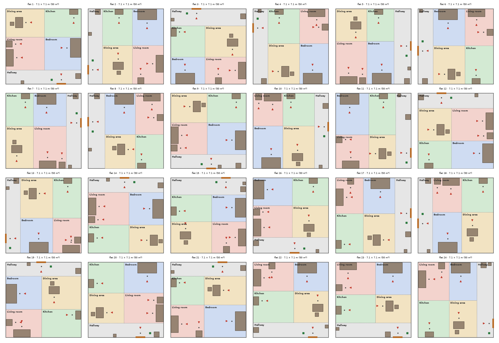
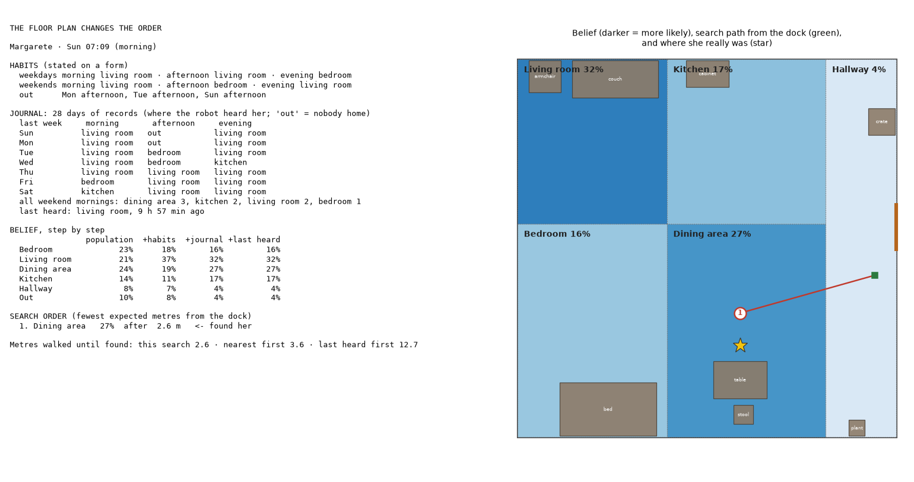

# homes: where is she? Synthetic Knock data and a Bayesian search

**Journal + habits + floor plan → where to search, in which order.** This folder makes synthetic residents living in
the MuJoCo arena, and a Bayesian search (`search.py`) that turns what is known about a resident into a search path for
the robot. Everything is simulated and drawn from a seed: the same seed gives the same files.

Start with the examples: `uv run --group ml python homes/search_demo.py` prints the results table below and writes six
worked examples to `data/search_examples/` (one picture each: the inputs, the belief step by step, the floor plan with
the search path).

## Commands

Run from this folder (`PROJECT` is the repo root; it holds the Python environment).

```bash
PROJECT=..
uv run --project $PROJECT --group ml python search_demo.py                          # the search: numbers + 6 examples
uv run --project $PROJECT --group ml python search_demo.py --tune                   # pick search.WEIGHTS (train residents)
uv run --project $PROJECT --group ml python generate.py --residents 8500 --csv      # data/*.parquet (+ .csv)
uv run --project $PROJECT --group ml python render.py                               # data/maps/sheet.png + 24 floor plans
uv run --project $PROJECT --group ml python prior.py                                # data/cold_prior.json
uv run --project $PROJECT --group ml python check.py --residents 10                 # TabPFN smoke test, ~6 min on CPU
uv run --project $PROJECT --group ml python example.py --row 30                     # one TabPFN example, explained
uv run --project $PROJECT --group ml python -m unittest test_homes.py -v            # 23 tests
```

## The flat: the MuJoCo arena with five named zones

Every flat is the simulator's arena (`sim/arena_furniture.xml`): one closed, square room of 50 m² (7.07 × 7.07 m) with the
arena's 8 pieces of furniture. The floor is divided into five zones, and every point of the floor is in exactly one:

| Zone | Furniture from the arena | Where she is |
|---|---|---|
| `bedroom` | bed | by the bed |
| `living_room` | couch, armchair | in front of the couch or the armchair |
| `dining_area` | table, stool | at the table |
| `kitchen` | cabinet (stands in for the kitchen counter) | by the cabinet |
| `hallway` | crate, plant pot, the door and the robot's dock | by the front door |

The hallway is a 1.3–1.6 m strip along one wall; the other four zones are the quarters of the rest of the room, and the
kitchen always shares an edge with the dining area. The split lines, which quarter is which, the furniture positions and
the hallway's wall are random. Furniture stands with its back to a wall, except the table and stool. Each zone has one
viewing pose per spot (the living room has two: couch and armchair), at least 0.30 m (the robot's radius) from all furniture.

`flats.arena_layout(flat, zone)` returns the layout `Arena.apply()` in `vision/scene.py` takes, with the red target pillar
standing in for her; a test opens flats in MuJoCo and checks that the furniture stands where the flat says.
`flats.to_app_zones(flat)` has the shape of `ZONES` in `app/knock.py` (the app still uses its old six names; switching it
is a follow-up). The arena has no real door; `door` is where it would be.



## The resident

A day has 3 parts: **morning 07:00–12:00, afternoon 12:00–18:00, evening 18:00–22:30**. Each resident has, for weekdays and
for weekends, a probability over the five zones for each part, plus a probability of being out (`residents.py`). Each day
she draws one zone per part. At night she is in the bedroom. Residents come in 8 flavours (`standard, early_riser,
night_owl, kitchen_person, day_care, restless, frail, living_room_reader`); each resident's table is a jittered copy, with
shop afternoons, day-care mornings or a weekend outing on chosen weekdays.

**Stated habits** (`residents.stated_habits`) are what she or her carer would write on a form: her usual zone per part of
the day (weekday and weekend) and her regular outings. The form is imperfect: in 30% of the parts of the day it names her
second most likely zone instead of the first.

## The Bayesian search (`search.py`)

The belief is counting with Bayes' rule; there is no model to train. For a check-in at a given hour and weekday:

1. **Population**: how often people are in each zone in this part of the day (from the train residents), worth 8 records.
2. **Habits**: her stated usual zone gets 2 extra records; `out` gets 32 on the weekday of a stated outing.
3. **Journal**: each of her own records in this part of the day (same weekday type) counts as one record.
4. **Last heard**: if the newest record is from this same part of today, she has most likely not moved. Bayes' rule, with a
   10% chance that the record was logged in a neighbouring zone.

The weights (8, 2, 32) are the ones with the lowest log loss on the check-ins of **train** residents (`--tune`).

The **floor plan** turns the belief into a search: `plan()` tries all 120 orders of the five zones and keeps the one with the
fewest expected metres from the dock until she is found. That is why it sometimes looks at a closer zone first: a 27% zone
2 m away can beat a 32% zone 6 m away. After a zone is checked and she is not there, `after_miss()` sets it to 0 and the
others share its probability.

### Results (`search_demo.py`: 120 test residents, 28 days of journal, 4,800 check-ins)

Test residents are people and flats the weights never saw. Metres: walked from the dock until she is found (check-ins with
her at home). Belief top: how often the most likely class (zones and `out`) is where she is.

| Strategy | Metres | Belief top | Log loss |
|---|---|---|---|
| Random order | 11.4 | | |
| Nearest zone first (floor plan only) | 7.2 | | |
| Last heard first, then nearest | 7.4 | | |
| Belief: population only | 6.7 | 38% | 1.51 |
| Belief: + her stated habits | 6.7 | 51% | 1.34 |
| Belief: + her journal | 6.4 | 54% | 1.21 |
| **Belief: + last heard (the full search)** | **5.6** | **72%** | **0.77** |
| Full belief, likeliest zone first (no floor plan) | 6.6 | | |
| Her true routine, planned (the best possible without last heard) | 6.1 | 57% | 1.10 |

- **The full search walks 22% less than "nearest first" and 25% less than "last heard first".**
- **Before she is heard in this part of the day** (half the check-ins), habits and journal must do the work: the belief's top
  is right 53% of the time against 54% for her true routine, which no method can beat. The search is 6.4 m against 6.2 m for
  the true routine, so there is little left to gain there.
- **Once she was heard in this part of the day**, the belief is right 92% of the time and the search walks 4.8 m.
- **The floor plan matters**: the same belief searched likeliest-first walks 6.6 m instead of 5.6 m (it checks fewer zones,
  but crosses the room more).
- **Out**: she was out in 15% of check-ins; the belief said out (over 50%) for 95% of those and was right 90% of the times it
  said so. The app could call her or her contact first in those cases instead of walking.

With one week of journal (the 7-day data in `data/`) the journal step adds only 1–2 points; it needs a few weeks of
records to correct a wrong form.

### The six examples (`data/search_examples/`)

| | What it shows |
|---|---|
| 1 | Her habits point the way: the form says kitchen on weekday afternoons; the population says living room; the search goes to the kitchen first and finds her. |
| 2 | The journal overrules the stated habit: the form says kitchen, but in 4 weeks she was there once; the kitchen drops from 28% to 14%. |
| 3 | Heard a moment ago: heard in the bedroom 11 minutes earlier, the bedroom goes from 18% to 85%. |
| 4 | The floor plan changes the order: the dining area (27%, close) is checked before the living room (32%, far), and she is there. |
| 5 | First guess wrong: not in the living room (47%); the bedroom goes from 35% to 66% and she is there. |
| 6 | Probably not home: a stated Tuesday-afternoon outing makes `out` 65%. |



## The data tables (for TabPFN)

`generate.py` writes, for 8,500 residents and 7 days: the **diary** (`diary.parquet`, days 0–4, 3 records a day, 127,500 rows),
**test check-ins** (`checkins.parquet`, days 5–6: 20 `checkin` and 5 `help` per day), `train.parquet` (102,000 rows of the
6,800 train residents, 26 numeric features, target `zone`), `residents.parquet`, `zones.parquet`, `flats.json.gz`,
`cold_prior.json` and `summary.json`. `data_r12/` is the same with 12 records a day (`--records-per-day 12`).

### How the robot "hears"

She is home → the robot hears her (her voice, the kettle, the TV) and places the sound in a zone from the **direction** its
microphones report and the **loudness**. 10% of records are logged in a neighbouring zone (`zone` ≠ `true_zone`); the
direction has 25° noise and the loudness 3 dB. She is out → the robot finds nobody: `zone = out`, voice empty. In this data
the hearing is simulated from her position, not real audio.

### Rows

| Columns | Meaning |
|---|---|
| `day, resident, source, hour, weekday, last_heard_zone, min_since_heard, voice_bearing_deg, voice_loudness_db, zone` | `zone` is the target; `day`, `resident`, `source` are not features |
| `slot, is_weekend, voice_zone_guess, voice_dist_m` | Slot 0/1/2 (3 = night, help calls only); the zone closest in direction to the voice; distance from the loudness |
| `hist_bedroom … hist_out`, `hist_n` | Her own history: the smoothed share of her earlier records **in the same slot and weekday type** per class |
| `resident_id, resident_name, resident_split, flat_id, archetype, true_zone` | IDs, never features |

Every flat has the same five zones, so the old flat columns (`n_zones`, `has_couch`, …) are gone. Only past information goes
into a row. `resident_split` is `test` for every fifth resident; fit and build priors from `train` only.

The flats are `flats.json.gz`: run `gunzip -k data/flats.json.gz` before `render.py`, `prior.py`, `check.py` or
`example.py`. `search_demo.py` makes its own residents in memory and needs no files.

### Cold-start prior (`prior.py`)

P(zone | weekday type, slot), counted from the train residents' diary. `probs(flat, hour, weekday)` returns
`(zone_probs, p_out)`, the shape of `PRIORS` in `app/knock.py`. Night uses a stated default: bedroom 0.85, kitchen 0.15.

### TabPFN smoke test (`check.py`)

Only `fit()` and `predict()` (the repo's rule: no fine-tuning). See `data/check_results.json` and
`data_r12/check_results.json`. The Bayesian search above is the baseline a TabPFN belief has to beat: plug its
`predict_proba` in place of `beliefs()` and compare metres in `search_demo.py`.

## Limits

- Each part of the day is an independent draw from her table, so she does not "stay" anywhere from one part to the next;
  "last heard" is only informative within the same part of the day.
- Straight-line distances between viewing poses: furniture can be in the way, so a real walk is a little longer.
- The stated habits' error rate (30%) and the population's routines are made up; the numbers say the method works on this
  data, not how well it works for a real person.
- No bathroom: the arena has none. Adding one means a piece or a marked area in both arena XML files.
